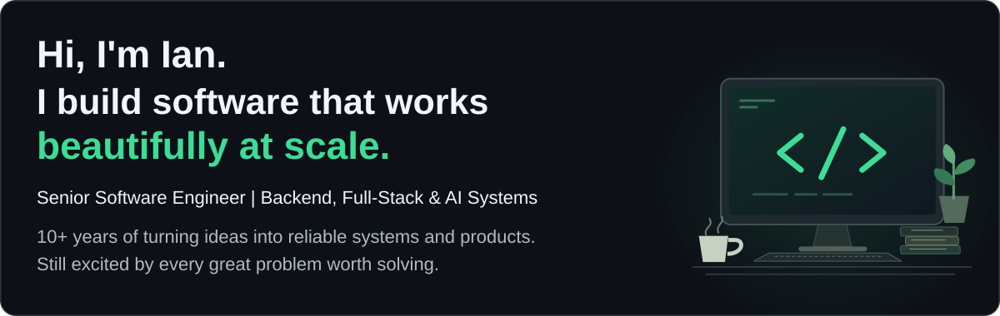
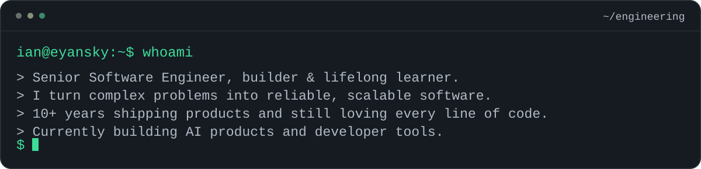
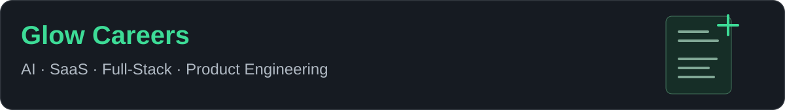
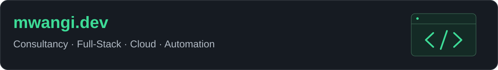
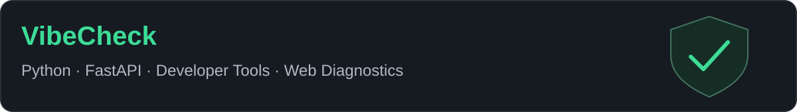

<picture>
  <source media="(max-width: 600px)" srcset="assets/hero-mobile.svg">
  
</picture>

**Python at the core. Backend depth. Full-stack ownership. Based in Kenya.**

[Explore my products](#user-content-featured-products) · [See my public code](#user-content-public-code--activity) · [Let's collaborate](#user-content-lets-build-something-great)

<picture>
  <source media="(max-width: 600px)" srcset="assets/terminal-mobile.svg">
  
</picture>

## About & Current Focus

<picture>
  <source media="(max-width: 600px)" srcset="assets/about-mobile.svg">
  
</picture>

## Technical Expertise

### Backend & Core Engineering

   

Python is my primary language. I build APIs, data models, background processing, and the services behind full-stack products.

**Also:** Flask · Node.js · REST APIs · Redis

### Frontend

 

React · Next.js · TypeScript · JavaScript · Tailwind CSS

### Cloud, DevOps & Infrastructure

 

AWS · Google Cloud · Docker · GitHub Actions · Vercel · Supabase · Cloudflare

### AI & Automation

LLM integrations · AI agents · Workflow automation · AI evaluation workflows · n8n

### Engineering Practices

System design · Microservices · Multi-tenant architecture · Automated testing · CI/CD · Performance optimization · Code review

## Featured Products

### Glow Careers

<a href="https://www.glow.careers">
  <picture>
    <source media="(max-width: 600px)" srcset="assets/projects/glow-mobile.svg">
    
  </picture>
</a>

An AI-powered career platform helping professionals build tailored resumes, improve their applications, and discover better opportunities.

**Highlights:** AI resume creation · Job discovery and application workflows · Full-stack product architecture · Automation and integrations

`AI` `SaaS` `Full-Stack` `Product Engineering`

[View Project → Glow Careers](https://www.glow.careers)

### mwangi.dev

<a href="https://www.mwangi.dev">
  <picture>
    <source media="(max-width: 600px)" srcset="assets/projects/mwangi-mobile.svg">
    
  </picture>
</a>

My software engineering consultancy, building custom websites, business platforms, integrations, dashboards, and automation solutions.

**Highlights:** Full-stack development · Custom business platforms · Cloud integrations · Engineering consultancy

`Consultancy` `Full-Stack` `Cloud` `Automation`

[View Project → mwangi.dev](https://www.mwangi.dev)

### VibeCheck

<a href="https://www.mwangi.dev/vibecheck">
  <picture>
    <source media="(max-width: 600px)" srcset="assets/projects/vibecheck-mobile.svg">
    
  </picture>
</a>

A developer-focused website diagnostic platform that evaluates security, performance, accessibility, and SEO, helping teams identify issues before they become production problems.

**Highlights:** Website diagnostics · Security and performance analysis · SEO and accessibility checks · Actionable developer recommendations

`Python` `FastAPI` `Developer Tools` `Web Diagnostics`

[View Project → VibeCheck](https://www.mwangi.dev/vibecheck)

## Experience & Engineering Impact

My background includes work with **Jobvite, Andela, and Turing**, alongside independent product development.

- **Production systems & modernization** — Modernizing Python applications, improving reliability, and maintaining background processing and complex backend workflows.
- **Architecture & cloud** — Designing multi-tenant services, APIs, databases, distributed workflows, cloud deployments, and CI/CD automation.
- **AI engineering** — Building AI-enabled applications, automation, and model evaluation workflows, including RLHF-related engineering work.
- **Product development** — Owning architecture, implementation, launch, iteration, and day-to-day operation.

## Engineering Principles

- **Build with purpose** — Solve meaningful problems.
- **Keep it clean** — Readable, maintainable code wins.
- **Engineer for reliability** — Systems should keep working.
- **Ship thoughtfully** — Great engineering creates measurable value.
- **Stay curious** — There's always another problem worth learning from.

## Public Code & Activity

Two places to explore how I approach engineering:

- [Multi-tenant maintenance API](https://github.com/Eyansky/multi-tenant-maintenance-api) — Django, PostgreSQL, tenant isolation, object permissions, and background workflows, with focused tests.
- [AgriWeather](https://github.com/Eyansky/agriweather) — Weather intelligence for Kenyan farmers, with English/Swahili support, AI advisories, and farm-image analysis.

[Browse all public repositories](https://github.com/Eyansky?tab=repositories) · [View GitHub contribution activity](https://github.com/Eyansky?tab=overview#year-list-container)

## Let's Build Something Great

I'm always excited to collaborate on meaningful software, challenging backend systems, and products that make a difference.

Building an ambitious product, working through an engineering challenge, or looking for an experienced engineer to join you? I'd love to connect.

[GitHub](https://github.com/eyansky) · [mwangi.dev](https://www.mwangi.dev) · [Glow Careers](https://www.glow.careers) · [Email Ian](mailto:ian@mwangi.dev)
